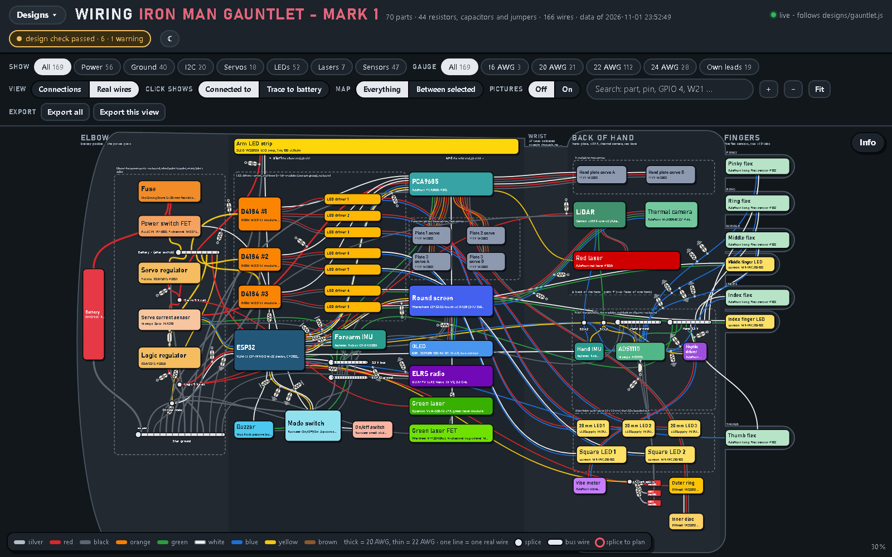
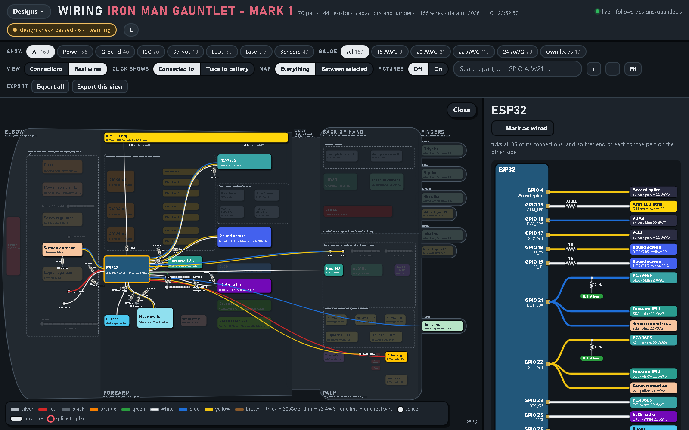
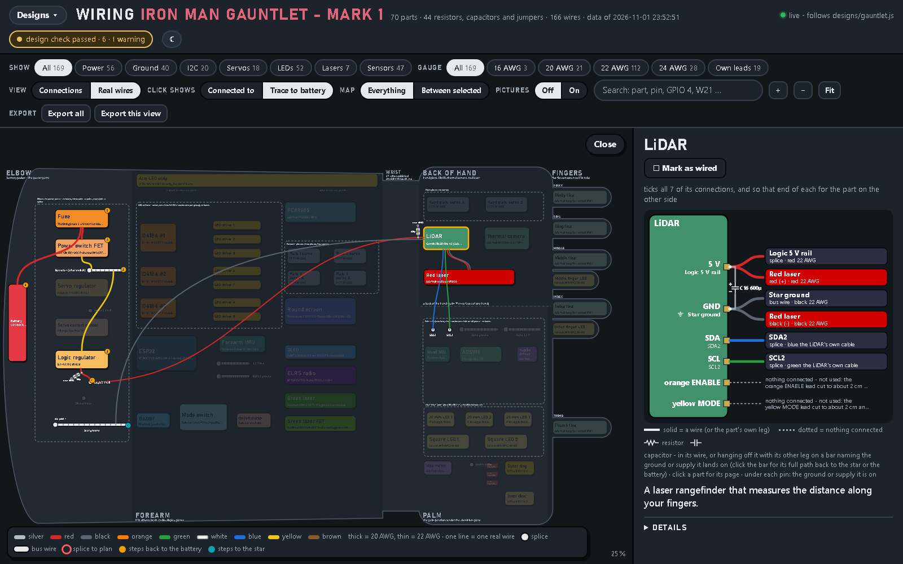
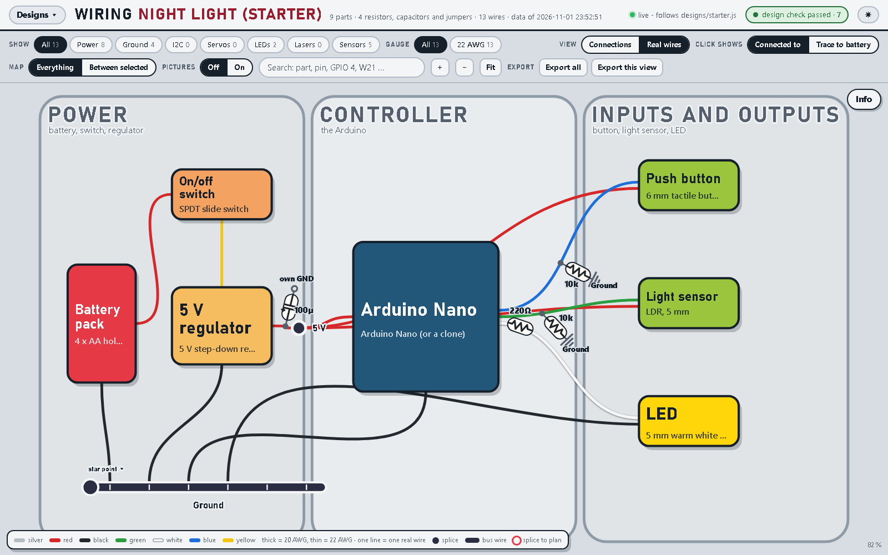

# Wiring Diagram App

<p align="center">
  
  
</p>

**One design file in, a full clickable wiring diagram out.** You describe your project's parts, pins and wires in one
file. The app draws every part where it sits, every wire in its real colour, and every resistor and capacitor on the
wire it belongs to. Then it checks the design for you.

It's one web page. There's nothing to install, no server and no internet needed.

**[▶ Open the live demo](https://tobym-engineering.github.io/wiring-diagram-app/)**: the example project, in your browser.

## What it does

- **One design file → the full diagram.** You write `designs/my-project.js` and the page draws it. Save the file and the page redraws by itself.
- **Click a part to see its connections.** You get the part drawn with every pin, the wire on each pin (colour, gauge), and what's at the other end. Click a wire for where it runs, its volts, colour, gauge and length.
- **Trace power to the battery.** *Trace to battery* lights up a part's power path back to the battery and its ground path back to the ground point, step by step: through the switch, the regulator, the splices.
- **Design checks.** The chip at the top turns red if a wire lands on a pin that doesn't exist, a part's supply never reaches the battery, a ground never reaches the ground point, or a supply or ground pin has no wire. It warns about crowded splices and wire colours that break the rules (5 V red, battery + yellow, ground black).
- **Also:** filter by system (power, ground, I²C, sensors…) or by wire gauge; search; *Between selected* to see only the wires between the parts you pick; export everything as one Markdown file; light and dark themes; tick parts off as you wire them.

<p align="center"></p>

## Run it

**What to install:** nothing except a web browser. It was tested in Chrome, and any up-to-date browser should work. No Node, Python, server or internet.

1. Download this repository: the green **Code** button → **Download ZIP**, then unzip it. Or `git clone` it.
2. Double-click **`index.html`**. The example opens: a wearable gauntlet with 70 parts and 166 wires.
3. Click around. **Designs ▾** (top left) switches to the small **starter** design.

## Your own design, step by step

A design is one file in the `designs` folder. Its whole text is a single call, `design({ ... });`, holding your
parts, junctions, resistors/capacitors and wires. The pieces below build a small night light; the finished file is
[`designs/starter.js`](designs/starter.js).

<p align="center"></p>

### 1. Start a file and open it

Create `designs/my-project.js` (a plain text file, any editor) with:

```js
design({
  "name": "My project",
  "canvas": { "w": 1800, "h": 1000 },
  "parts": [],
  "splices": [],
  "comps": [],
  "wires": []
});
```

In the app, click **Designs ▾**, type `my-project` and press **Open**. Or open `index.html?design=my-project`.
Leave the page open: every time you save the file, it redraws.

### 2. Add the battery

Parts go in `"parts"`. Each one has an `id` (wires use it), a name, a box on the canvas and its pins:

```js
{ "id": "battery", "name": "Battery pack", "box": [70, 380, 150, 260], "fill": "#E63946", "source": true,
  "pins": [
    ["PLUS", "+ (red lead)", "plus"],
    ["MINUS", "- (black lead)", "minus"]
  ] }
```

- `box` is `[x, y, width, height]` on the canvas, with x to the right and y down.
- `source: true` marks the battery: every power path ends there.
- Each pin is `[ID, label, role]`. The role tells the tracer what the pin is:
  - `plus` / `minus`: the battery's two ends
  - `pwr`: a pin that takes power
  - `gnd`: a ground pin
  - leave the role out for a signal pin

### 3. Add the ground point

Junctions, where several wires meet, go in `"splices"`. Mark the main ground with `"star": true`: every ground is
traced to it. A splice has one pin, `BUS`.

```js
"splices": [
  { "id": "gnd", "name": "Ground", "box": [120, 860, 520, 22], "bar": true, "star": true }
]
```

`"bar": true` draws a bus bar. Without it the splice is a dot (`"box": [x, y, 40, 40]`).

### 4. Add a regulator and say how power passes through it

```js
{ "id": "reg", "name": "5 V regulator", "box": [300, 430, 220, 170], "fill": "#F6BD60",
  "pins": [
    ["VIN", "VIN: from the battery", "pwr"],
    ["GND", "GND", "gnd"],
    ["VOUT", "VOUT: 5 V out"]
  ],
  "links": [
    ["feed", "VIN", "VOUT", "through the regulator"]
  ] }
```

`links` tell the tracer how power gets through a part:

- `feed` means power flows from the first pin to the second. Use it for regulators, switches and fuses.
- `tie` means the two pins are the same connection on the board, like two GND pins.

### 5. Wire them

Each wire goes from one pin to another, written `part.PIN`. A splice's pin is `BUS`.

```js
"wires": [
  { "from": "battery.PLUS", "to": "reg.VIN", "cat": "raw", "awg": "22", "colour": "yellow", "text": "battery + to the regulator" },
  { "from": "battery.MINUS", "to": "gnd.BUS", "cat": "gnd", "awg": "22", "colour": "black", "text": "the battery's ground" },
  { "from": "reg.GND", "to": "gnd.BUS", "cat": "gnd", "awg": "22", "colour": "black", "text": "the regulator's ground" }
]
```

- `cat` is what the wire carries:

  | `cat` | Carries |
  |---|---|
  | `raw` | battery + after the switch |
  | `logic` | 5 V |
  | `v33` | 3.3 V |
  | `gnd` | ground |
  | `i2c` | I²C bus |
  | `sig` | any other signal |

- `colour` is the real wire's colour: `red`, `black`, `yellow`, `blue`, `green`, `white`, `orange`, `purple`, `grey`, `brown`, `silver`, or any `#rrggbb`.
- `awg` is the gauge. `len` and `cm` (optional) give its length.

Save. The battery, regulator and ground bar appear, wired. Click the regulator, then **Trace to battery**.

### 6. Add the board, sharing the 5 V through a splice

```js
{ "id": "nano", "name": "Arduino Nano", "box": [700, 330, 320, 330], "fill": "#22577A", "mcu": true,
  "pins": [
    ["V5", "5V: power in", "pwr"],
    ["GND", "GND", "gnd"],
    ["D9", "D9: the LED (PWM)"]
  ] }
```

Add a dot splice to `"splices"`:

```js
{ "id": "v5", "name": "5 V", "box": [560, 500, 40, 40], "lab": "5 V", "lp": "r" }
```

Then wire `reg.VOUT → v5.BUS` and `v5.BUS → nano.V5` (`"cat": "logic"`, red), and `nano.GND → gnd.BUS`.
`"mcu": true` makes the board's `GPIOn` / `Dn` pins searchable.

### 7. Add an LED and its resistor

Resistors, capacitors and jumpers go in `"comps"`. The app draws each one on the wire it belongs to:

```js
"comps": [
  { "ref": "R1", "kind": "R", "value": "220 Ω", "job": "LED resistor", "part": "the LED's resistor",
    "why": "so the LED takes about 15 mA", "where": "at the Arduino's D9 pin, in line",
    "a": "nano.D9", "b": "led.ANODE", "series": true,
    "wire": { "cat": "sig", "awg": "22", "colour": "white", "text": "the LED's drive" } }
]
```

- `a` is the pin it's soldered to. `b` is where its other leg goes.
- `"series": true` with a `wire` puts it in line: the wire runs from its other leg to `b`.
- Without `series`, it hangs off pin `a` with its other leg on `b`:
  - a pull-down to ground: `"a": "nano.D2", "b": "gnd.BUS"`
  - a capacitor across a part's own pins: `"a": "reg.VOUT", "b": "reg.GND"`
- `kind` is one of:
  - `R`: resistor
  - `CN`: ceramic capacitor
  - `CE`: electrolytic capacitor, with its + on `a`
  - `J`: jumper

Add the LED itself as a part, with pins `ANODE` and `CATHODE` (role `gnd`). Then wire `led.CATHODE → gnd.BUS`.

### 8. Read the check

The chip at the top says **design check passed** or how many checks failed. Click it for the report. Each failure names
what to fix. For example, *"LED (led.CATHODE) is a ground that reaches no ground point"* means its ground wire is
missing. A **!** on a part's box means it has no part number yet; add one with `"pn"`.

### 9. Optional extras

| Field | What it adds |
|---|---|
| `"about"` | Markdown for the **Info** panel; a multi-line `` `backtick string` `` works |
| `"zones"` | Labelled regions, e.g. `{ "id": "power", "name": "POWER", "x0": 0, "x1": 600 }`; give each part a `"zone"` |
| `"outlines"` | Dashed boxes round a group: `{ "name": "...", "x": 0, "y": 0, "w": 400, "h": 300 }` |
| `"volts"` | The text for each category in a wire's panel: `{ "raw": "6 V: the battery pack" }` |
| Part `"what"`, `"desc"`, `"warn"` | One plain sentence, a longer description, a warning box |
| Part `"pn"`, `"maker"`, `"url"`, `"status"` | Part number, maker, product page, `owned` / `to buy` |
| Part `"photo"` | `"nano.jpg"` shows `photos/nano.jpg` (make a `photos` folder next to `index.html`) |
| Wire `"ownLead": true` | The part's own lead (a battery holder's red wire): the colour rules leave it alone |
| `"colourRules"` | `"warn"` (default), `"fail"` or `"off"` |

The example, [`designs/gauntlet.js`](designs/gauntlet.js), uses every field. The full list is at the top of
[`generate.js`](generate.js).

## Files

```
index.html     the app - open this
generate.js    turns a design file into the drawing and runs the checks
designs/       one file per design: gauntlet.js (the example), starter.js (the guide above)
docs/          the screenshots in this README
```

## The example

The example is **Iron Man Gauntlet Mark 1**, a wearable forearm gauntlet that flies a tiny drone by hand gesture.
It's the real arm: every part, pin, wire, resistor and capacitor, drawn from [`designs/gauntlet.js`](designs/gauntlet.js).
The build itself is in [Iron-Man-Gauntlet-Mark-1](https://github.com/TobyM-engineering/Iron-Man-Gauntlet-Mark-1).

## License

[MIT](LICENSE): use it for your own projects.
